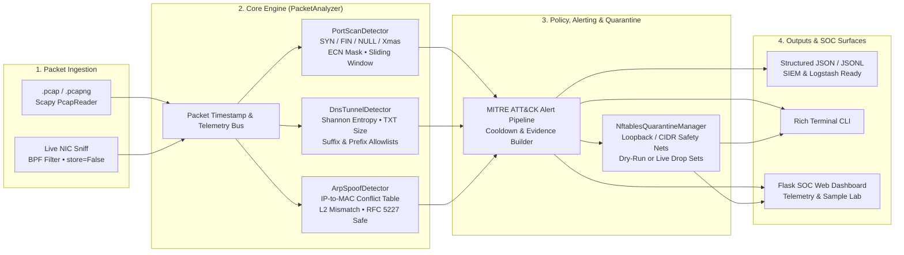

# NetGuard — Python Packet Anomaly & Stealth Recon Detector

[](https://www.python.org/downloads/)
[](https://scapy.net/)
[](https://netfilter.org/projects/nftables/)
[](pyproject.toml)

**NetGuard** is a stateful network intrusion detection system (IDS), forensic telemetry analyzer, and automated `nftables` quarantine tool built with **Python**, **Scapy**, **Flask**, **Rich**, and **pytest**. It inspects both live network interfaces and offline `.pcap` / `.pcapng` captures for stealth TCP reconnaissance, DNS tunneling/exfiltration, and Layer-2 ARP cache poisoning—emitting MITRE ATT&CK-enriched JSON/JSONL alerts and optional timeout-scoped host quarantine rules.

> **Sample Resume Bullet:**
> *Developed a Python and Scapy network anomaly detector capable of identifying stealth TCP scans (SYN/FIN/Xmas/NULL), ARP spoofing, and high-entropy DNS tunneling in real time, automating timeout-scoped host quarantine via Linux nftables and visualizing forensic telemetry in a Flask SOC dashboard.*

---

## System Architecture



*(See [docs/ARCHITECTURE.md](docs/ARCHITECTURE.md) for sequence, state-machine, quarantine decision, and lab topology diagrams.)*

---

## Key Capabilities

- **Stealth & Half-Open Port Scan Detection (`T1046`):**
  - Masks TCP flags to the standard 6 control bits (`flags & 0x3F`) so RFC 3168 ECN (`ECE`/`CWR`) bits do not blind or confuse flag classifiers.
  - Detects **Half-Open SYN** (`0x02`), **FIN** (`0x01`), **NULL** (`0x00`), and **Xmas** (`0x29`: `FIN|PSH|URG`) scans over both **IPv4 and IPv6**.
  - Tracks completed 3-way TCP handshakes (`ACK` without `SYN`) to exclude legitimate client connections, counts **unique destination ports** (ignoring retransmissions), and uses a **packet-timestamp sliding window** (handling out-of-order captures accurately).
- **DNS Tunneling & Exfiltration Detection (`T1071.004`, `T1048.003`):**
  - Computes **Shannon entropy** across subdomain payloads while preserving mixed-case Base64 character distributions and handling 2-part public suffixes (`.co.uk`, `.com.au`, etc.).
  - Detects oversized `TXT` tunneling queries, high-entropy `A`/`AAAA` C2 beacons, and abnormally long chained subdomains over UDP and TCP DNS.
  - Filters benign reverse lookups (`in-addr.arpa`, `ip6.arpa`), mDNS (`.local`), and standard email/ACME TXT prefixes (`_dmarc.`, `_domainkey.`, `_spf.`, `_acme-challenge.`).
- **ARP Cache Poisoning & MITM Detection (`T1557.002`):**
  - Maintains a persistent IP-to-MAC binding table (supporting trusted static bindings via `--arp-static`) and preserves original ground truth on conflict instead of overwriting it.
  - Flags IP-to-MAC flips (`ARP_IP_MAC_CONFLICT`) and Layer-2 Ethernet vs. ARP sender MAC mismatches (`ARP_HEADER_MISMATCH`), while safely ignoring RFC 5227 Duplicate Address Detection probes (`0.0.0.0`).
- **Automated `nftables` Quarantine Engine:**
  - Safe **dry-run mode by default**; live drops use `subprocess.run` with explicit argument lists (`shell=False`), strict IP validation, and kernel-enforced auto-expiring `timeout` sets (`table inet netguard`).
  - Built-in non-blockable safety nets protect loopback (`127.0.0.0/8`, `::1/128`), link-local (`169.254.0.0/16`, `fe80::/10`), multicast, broadcast, and custom CIDR allowlists.
- **Interactive SOC Web Dashboard & Demonstration Lab:**
  - Zero-CDN offline-ready Flask dashboard with one-click sample `.pcap` execution, drag-and-drop custom PCAP upload, live threshold tuning, inline SVG forensic telemetry charts, MITRE ATT&CK evidence inspector, JSON/JSONL export, and an interactive `nftables` allowlist simulator.

---

## Quickstart

### 1. Setup Virtual Environment

```bash
git clone https://github.com/lonejohn04/Packet-Anomaly-Stealth-Recon-Detector.git
cd Packet-Anomaly-Stealth-Recon-Detector

python3 -m venv .venv
.venv/bin/pip install --upgrade pip
.venv/bin/pip install -r requirements.txt
.venv/bin/pip install -e . --no-build-isolation
```

### 2. Generate Built-in Sample PCAPs

Six deterministic `.pcap` captures are included under `samples/` (and can be regenerated anytime):

```bash
.venv/bin/netguard generate-samples --output-dir samples
```

### 3. Run Offline PCAP Analysis (CLI)

```bash
# Analyze full multi-stage attack kill chain with nftables dry-run quarantine preview
.venv/bin/netguard analyze samples/04_full_killchain_demo.pcap --quarantine

# Verify zero false positives on clean corporate baseline traffic
.venv/bin/netguard analyze samples/05_benign_baseline.pcap

# Export SIEM-ready JSON & JSONL outputs
.venv/bin/netguard analyze samples/04_full_killchain_demo.pcap \
  --quarantine \
  --json /tmp/netguard_report.json \
  --jsonl /tmp/netguard_alerts.jsonl
```

### 4. Launch the Interactive SOC Web Dashboard

```bash
.venv/bin/netguard web --host 127.0.0.1 --port 8080
```

Open `http://127.0.0.1:8080` in your browser to run the 6 built-in demonstration `.pcap` files, upload your own Wireshark captures, tune detector thresholds live, and inspect telemetry charts.

### 5. Run the Automated Edge-Case Test Suite

```bash
.venv/bin/pytest -v
```

---

## Demonstration Sample Files (`samples/`)

| Sample File | Scenario | Expected Alerts (Default Config) |
| :--- | :--- | :--- |
| [01_stealth_port_scans.pcap](samples/01_stealth_port_scans.pcap) | Completed TCP sessions + single-port retries + SYN/FIN/NULL/Xmas scans | `TCP_SYN_SCAN`, `TCP_FIN_SCAN`, `TCP_NULL_SCAN`, `TCP_XMAS_SCAN` (4 alerts) |
| [02_dns_tunneling.pcap](samples/02_dns_tunneling.pcap) | Normal/PTR/`_dmarc` DNS + Base64 A beacons + oversized TXT tunnels + long subdomain | `DNS_HIGH_ENTROPY` (x2), `DNS_TXT_TUNNELING` (x2), `DNS_LONG_SUBDOMAIN` (5 alerts) |
| [03_arp_spoofing.pcap](samples/03_arp_spoofing.pcap) | RFC 5227 probes + stable ARP + gratuitous gateway spoofing + L2 header mismatch | `ARP_IP_MAC_CONFLICT`, `ARP_HEADER_MISMATCH` (2 alerts) |
| [04_full_killchain_demo.pcap](samples/04_full_killchain_demo.pcap) | Realistic multi-stage kill chain across Recon, MITM, and DNS Exfiltration | `TCP_SYN_SCAN`, `TCP_XMAS_SCAN`, `ARP_IP_MAC_CONFLICT`, `DNS_HIGH_ENTROPY`, `DNS_TXT_TUNNELING` (5 alerts) |
| [05_benign_baseline.pcap](samples/05_benign_baseline.pcap) | Clean corporate traffic (20 completed sessions, retries, PTR, `_dmarc`, ICMP, IPv6) | **0 alerts** (False-positive verification) |
| [06_edge_cases_stress.pcap](samples/06_edge_cases_stress.pcap) | Slow scan (45s), IPv6 SYN scan, loopback FIN scan, ECN handshake, malformed DNS bytes | `TCP_SYN_SCAN` (IPv6), `TCP_FIN_SCAN` (`127.0.0.1` -> `skipped_allowlisted`); slow scan fires at `--window 60` |

---

## MITRE ATT&CK Coverage

| Alert Type | Severity | MITRE Tactic | Technique |
| :--- | :--- | :--- | :--- |
| `TCP_SYN_SCAN` | `HIGH` | Discovery | `T1046` — Network Service Discovery |
| `TCP_FIN_SCAN` / `TCP_NULL_SCAN` / `TCP_XMAS_SCAN` | `CRITICAL` | Discovery | `T1046` — Network Service Discovery |
| `DNS_HIGH_ENTROPY` | `HIGH` | Command and Control | `T1071.004` — Application Layer Protocol: DNS |
| `DNS_LONG_SUBDOMAIN` | `MEDIUM` / `HIGH` | Command and Control | `T1071.004` — Application Layer Protocol: DNS |
| `DNS_TXT_TUNNELING` | `CRITICAL` | Exfiltration | `T1048.003` — Exfiltration Over Unencrypted Non-C2 Protocol |
| `ARP_IP_MAC_CONFLICT` | `CRITICAL` | Credential Access | `T1557.002` — Adversary-in-the-Middle: ARP Cache Poisoning |
| `ARP_HEADER_MISMATCH` | `HIGH` | Credential Access | `T1557.002` — Adversary-in-the-Middle: ARP Cache Poisoning |

---

## Documentation Index

- **[Complete Documentation Guide](docs/DOCUMENTATION.md)** — Installation, live capture permissions (`CAP_NET_RAW`), protocol detection math, tuning false positives, `nftables` deployment & rollback, and troubleshooting.
- **[System Architecture & Diagrams](docs/ARCHITECTURE.md)** — Component, sequence, sliding-window state machine, `nftables` decision flow, and lab network diagrams.
- **[Alert & Telemetry JSON Schema](docs/ALERT_SCHEMA.md)** — Field-level specification for JSON/JSONL SIEM integration and `jq` recipes.
- **[Sample Captures Guide](samples/README.md)** — Packet-by-packet breakdown and interactive demo scripts.

---

## Interview Talking Points (Why Engineering Decisions Matter)

1. **Why mask TCP flags (`flags & 0x3F`)?** Modern OS stacks negotiate Explicit Congestion Notification (`ECE`/`CWR`). Without masking the upper two bits, a stealth scanner or ECN-capable host breaks exact flag matching (`== 0x02`).
2. **Why use packet capture timestamps (`pkt.time`) instead of wall-clock `time.time()`?** Offline `.pcap` replays run thousands of packets per millisecond. Using `time.time()` collapses a 2-hour slow scan into a 5ms burst and causes false positives; anchoring the sliding window to `pkt.time` makes offline and live detection mathematically identical.
3. **Why ignore `0.0.0.0` in ARP inspection and use `nftables` timeout sets?** RFC 5227 Duplicate Address Detection sends probes with `psrc=0.0.0.0` during normal DHCP leases—flagging them would flood any LAN. Meanwhile, kernel `nftables` sets with `flags timeout` automatically expire blocked attacker IPs without needing a separate cleanup daemon.
