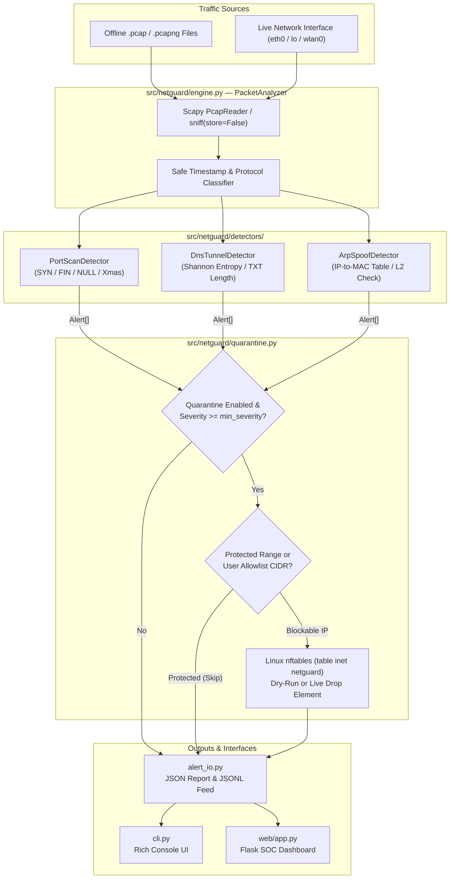
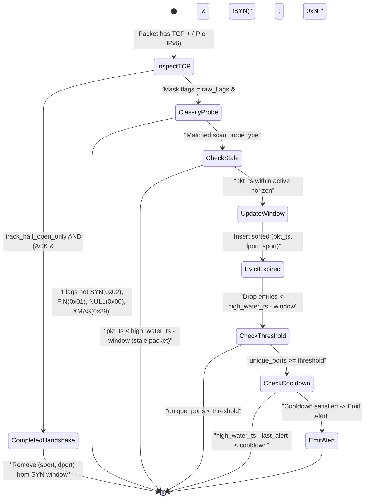
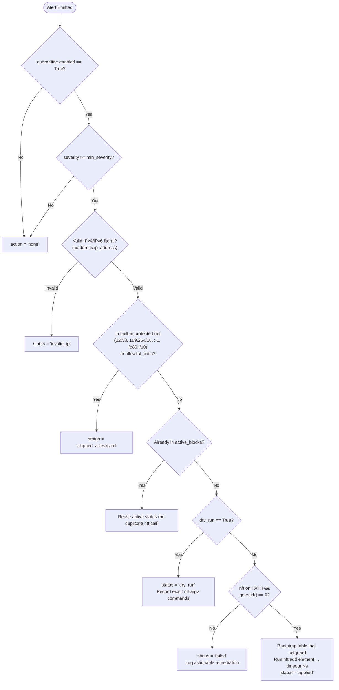
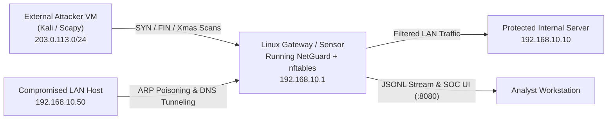

# NetGuard System Architecture & Diagrams

This document provides visual architecture, sequence, state-machine, quarantine decision, and deployment topology diagrams for NetGuard.

---

## 1. High-Level Component Architecture



### Terminal ASCII Reference Diagram

```text
  [.pcap / .pcapng] ──┐
                      ├──> [PacketAnalyzer] ──┬──> [PortScanDetector]  (SYN/FIN/NULL/Xmas)
  [Live Interface]  ──┘                       ├──> [DnsTunnelDetector] (Entropy / TXT Size)
                                              └──> [ArpSpoofDetector]  (IP<->MAC Conflicts)
                                                           │
                                                           ▼
                                               [MITRE Alert Pipeline]
                                                 ├──> JSON / JSONL Export
                                                 ├──> Rich CLI / Flask SOC UI
                                                 └──> [NftablesQuarantineManager]
                                                        ├── Protected / Allowlist -> Skip
                                                        └── Threat IP -> nft add element (timeout)
```

---

## 2. Packet Processing & Quarantine Sequence

```mermaid
sequenceDiagram
    autonumber
    participant Src as PCAP / Live NIC
    participant Eng as PacketAnalyzer
    participant Det as Detectors (TCP/DNS/ARP)
    participant Q as NftablesQuarantineManager
    participant Out as JSONL / CLI / Web UI

    Src->>Eng: Deliver raw packet + pkt.time
    Eng->>Eng: Classify protocol &amp; update timeline bucket
    Eng->>Det: process_packet(pkt, pkt_ts)
    alt Malformed layer payload
        Det-->>Eng: Safely skip bad layer (no crash)
    else Benign or below threshold
        Det-->>Eng: []
    else Anomaly threshold breached
        Det-->>Eng: Alert (with MITRE ATT&amp;CK &amp; Evidence)
        Eng->>Q: evaluate_alert(alert)
        alt Quarantine disabled or below min_severity
            Q-->>Eng: quarantine_action = "none"
        else Protected loopback/link-local/allowlist IP
            Q-->>Eng: quarantine_action = "skipped_allowlisted"
        else Dry-run mode
            Q-->>Eng: quarantine_action = "dry_run" + nft cmd preview
        else Live root mode with nft binary
            Q->>Q: subprocess.run(["nft", "add", "element", ...])
            Q-->>Eng: quarantine_action = "applied"
        end
        Eng->>Out: Emit enriched Alert &amp; update telemetry
    end
```

---

## 3. PortScanDetector Sliding-Window State Machine



---

## 4. `nftables` Quarantine Decision Flow



---

## 5. Recommended Home-Lab Deployment Topology


